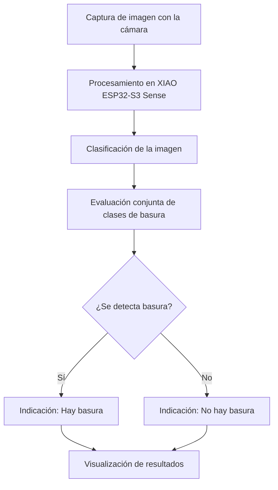

# Presentación 2 — Avance #2

**TEI201 · Taller de Diseño en Ingeniería**  
**Proyecto:** Cámara inteligente para la detección de basura  
**Fecha de evaluación:** 19 de octubre de 2026

> **Propósito de esta carpeta:** reunir el material de la segunda presentación y la evidencia del funcionamiento del prototipo Alpha IoT.

## 1. Objetivo del avance

Demostrar el funcionamiento real de un prototipo IoT capaz de **detectar la presencia de basura mediante una cámara**, integrando captura de imágenes, procesamiento, conectividad y una respuesta observable. Además, presentar la propuesta de encapsulado, las mejoras realizadas y la documentación técnica del sistema.

La evaluación considera una **demostración presencial de 5 a 7 minutos**, seguida de **2 minutos de retroalimentación**. Todos los integrantes deben participar.

## 2. Descripción del prototipo

El proyecto utiliza una **Seeed Studio XIAO ESP32-S3 Sense**, equipada con cámara, para analizar imágenes del entorno e identificar si existe basura.

La decisión principal del sistema es **«Hay basura» o «No hay basura»**. Las categorías reconocidas por el modelo permiten interpretar la imagen, pero el objetivo final no es identificar un material específico, sino establecer la **presencia de basura considerando conjuntamente las clases relevantes**.

### Flujo de funcionamiento

### Componentes principales

| Componente | Función |
| --- | --- |
| **XIAO ESP32-S3 Sense** | Ejecuta el programa y coordina el procesamiento. |
| **Cámara OV3660** | Captura las imágenes que analiza el sistema. |
| **Conectividad Wi-Fi** | Permite comunicar o visualizar información del dispositivo. |
| **Modelo de clasificación** | Obtiene resultados para las clases consideradas. |
| **Salida de resultados** | Presenta la conclusión de detección y la información del análisis. |

## 3. Aspectos que deben demostrarse

### A. Prototipo Alpha IoT funcional

- Captura de imágenes y procesamiento en tiempo real.
- Resultado coherente ante distintos objetos y ante ausencia de basura.
- Conectividad y transmisión de información estables.
- Integración del flujo **sensor → procesamiento → respuesta**.
- Funcionamiento continuo durante **al menos 5 minutos**.

### B. Conceptualización del encapsulado

- Modelo 3D que represente el volumen del dispositivo.
- Dimensiones compatibles con los componentes reales.
- Ubicación de cámara, placa, alimentación y conexiones.
- Justificación de materiales, protección, acceso y mantenimiento.
- Consideraciones para una instalación en el entorno de uso.

### C. Iteración y pruebas

Documentar cómo evolucionó el prototipo desde la idea inicial:

1. Problemas identificados durante el desarrollo.
2. Modificaciones realizadas al hardware, código o modelo.
3. Pruebas efectuadas y resultados observados.
4. Limitaciones actuales y próximos pasos.

### D. Documentación técnica

La evidencia técnica debe incluir:

- **Código fuente:** comentado, ordenado y con descripción de su lógica, librerías, variables y funciones clave.
- **Diagrama de conexiones:** componentes y pines utilizados.
- **Registro de iteraciones:** problemas, soluciones y decisiones técnicas.
- **Diseño 3D:** propuesta de encapsulado y justificación.